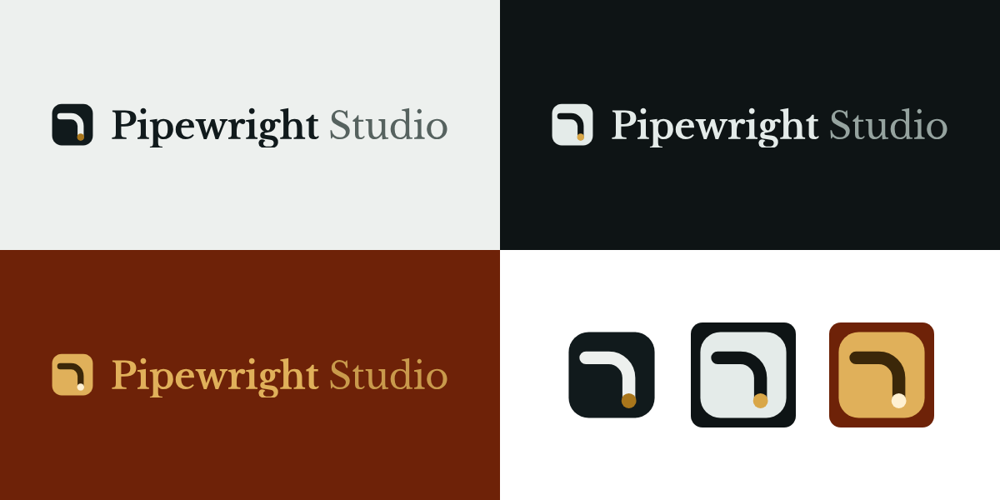

# Pipewright Studio logo

The mark is a **pipe elbow** (flow turning a corner) ending in a **brass dot** (the output: pipeline). The wordmark is **Libre Baskerville**: "Pipewright" Bold, "Studio" Regular in a muted tone.

All wordmark text is converted to outlines, so the SVGs look the same everywhere without the font installed.

## Files
| File | Use |
|---|---|
| `pipewright-logo-light.svg` / `.png` | Full logo on light backgrounds (website, documents, proposals) |
| `pipewright-logo-dark.svg` / `.png` | Full logo on dark backgrounds (slides, dark posters) |
| `pipewright-logo-brass.svg` / `.png` | Festive or premium use on warm, dark backgrounds |
| `pipewright-mark-*.svg` / `-1024.png` | Icon only: social profile pictures, app icons, stamps |
| `favicon-32.png`, `apple-touch-icon-180.png` | Browser tab and phone home-screen icons |

## Colours
| Name | Hex |
|---|---|
| Ink | `#111A1C` |
| Paper | `#EDF0EE` |
| Brass (light bg) | `#A9761B` |
| Brass (dark bg) | `#D9A748` |
| Brass (festive) | `#E0B05A` |

## Rules
- Keep clear space around the logo of at least the height of the mark.
- Don't stretch, recolour outside the palette above, or retype the wordmark in another font.
- Minimum size: mark 24px; full logo 140px wide.
